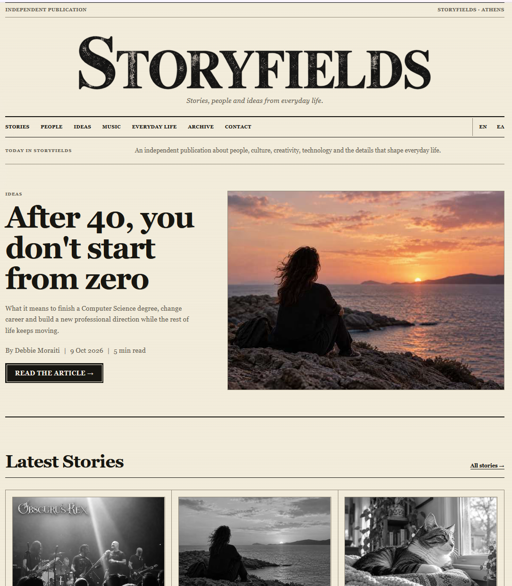
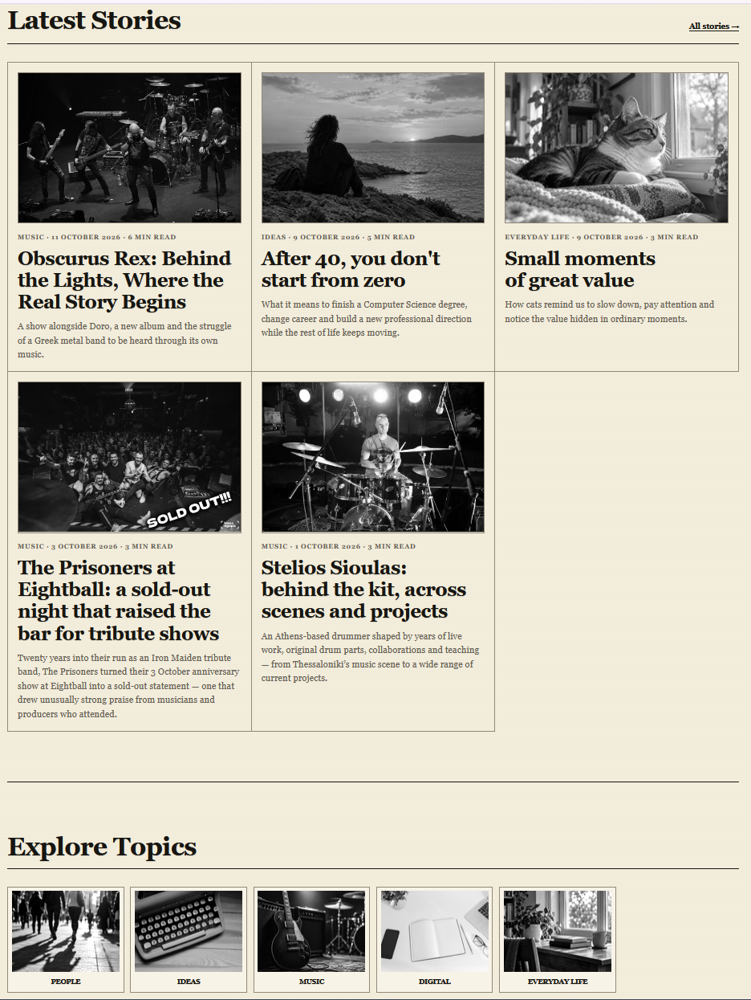
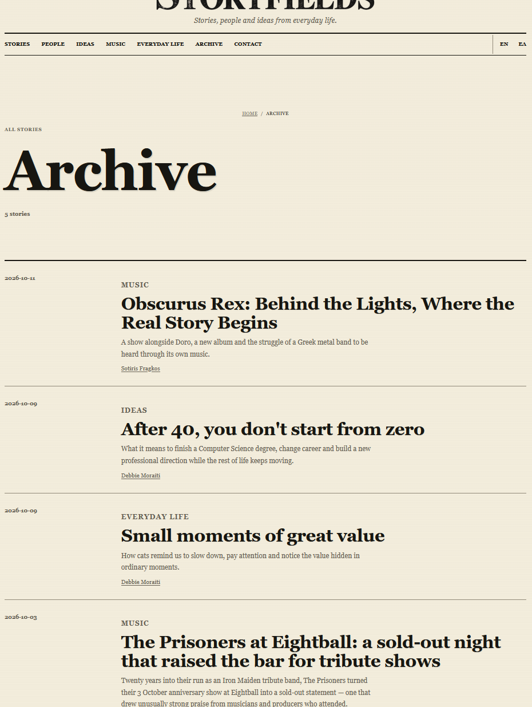
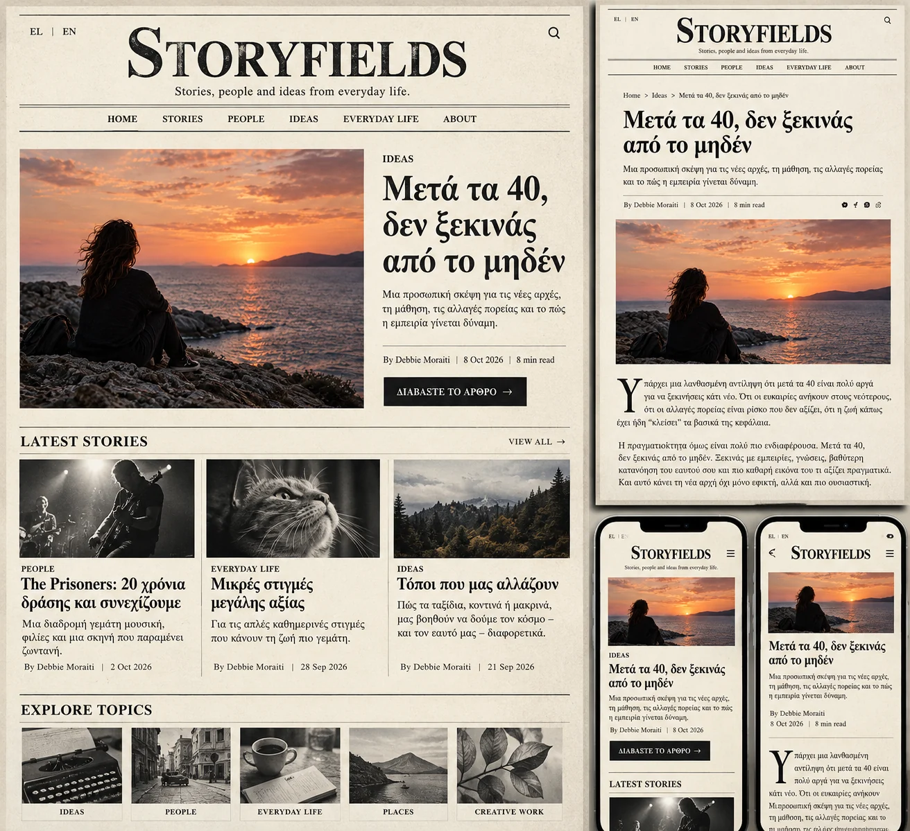

# Storyfields — Independent Editorial Publication

**Web Design & Development · Editorial Platform · 2026**

[Visit the live website](https://storyfields.gr/) · [Explore the source code](https://github.com/DebbieMoraiti/publication-site)

## Visual walkthrough

The screenshots below show the **published Storyfields website**, distinct from the earlier concept mockup.

**01 — Homepage / lead story**

*Homepage and featured-story presentation. [View live](https://storyfields.gr/).*

**02 — Homepage / latest stories & topics**

*Article-card grid, reading metadata and editorial topics. [View live](https://storyfields.gr/#stories).*

**03 — Topic / archive page**

*How readers browse the publication's editorial content. [Explore the archive](https://storyfields.gr/el/archive/).*

## Design concept & responsive exploration

Before the final launch, I explored a newspaper-inspired visual direction through a **concept mockup** showing a desktop homepage, an article layout and mobile views together.

The exploration helped establish the editorial hierarchy, serif typography, paper-like palette and responsive approach. **This is an early design visualization, not a screenshot of the published site.** The live implementation evolved from it, so some content and layout details differ.

*Early design exploration — concept mockup, not the published website.*

## Overview

Storyfields is an independent editorial website featuring stories about people, music, creativity and everyday life. It is a real, published project built to support ongoing writing and content management in **English and Greek**.

The goal was to combine the visual character of a traditional newspaper with the navigation, maintainability and accessibility expected of a modern website.

## My role

**Website design and development**, including the editorial layout, front-end implementation, bilingual content structure, publishing workflow, technical SEO, deployment configuration and iterative maintenance.

## Design approach

The visual system draws on print-editorial design: warm paper-like backgrounds, serif typography, fine dividing rules, and a consistent content grid. The lead story receives a larger visual treatment, while the other story thumbnails appear in black and white on the homepage. Inside articles, images retain their original visual character.

The design adapts to different screen sizes without losing its editorial hierarchy.

## Key implementation decisions

- **Astro and static output:** page generation suited to a content-focused publication.
- **Bilingual publishing:** separate English and Greek routes, with localized headlines, content and navigation.
- **Structured editorial content:** articles, authors, topics and tags; draft/published states; featured-story selection, article archives and related-story navigation.
- **Pages CMS:** a content editing workflow for editorial material, separate from technical site configuration. Build-time validation checks content relationships and publishing rules.
- **Search and discovery:** canonical and hreflang tags, structured data, XML sitemaps, RSS feeds and article metadata.
- **Usability and accessibility:** responsive layouts and images, alternative text, keyboard focus styles, skip navigation and reduced-motion support.
- **Security and privacy-conscious integrations:** generated CSP/security configuration, a protected contact-form workflow, and Cloudflare Web Analytics integration.

## Challenges and solutions

**Maintaining two languages without duplicating the site.** Localized content and route helpers share the same underlying components and editorial model.

**Making publishing manageable.** JSON content collections and Pages CMS provide an editing path while keeping configuration and validation in the codebase.

**Preserving editorial style across devices.** Flexible grids, responsive images and typographic rules allow the layout to adapt while retaining the newspaper-inspired aesthetic.

## Outcome

A published, bilingual editorial platform with a repeatable workflow for new stories. Storyfields demonstrates how I approach a project beyond its initial appearance: content architecture, implementation, publishing, discoverability and ongoing improvements.

This case study describes implemented project features, not unverified claims about audience size, traffic or business results.

---

**Stack:** Astro · TypeScript/JavaScript · CSS · Pages CMS · GitHub · Cloudflare Web Analytics

**Links:** [Storyfields.gr](https://storyfields.gr/) · [GitHub repository](https://github.com/DebbieMoraiti/publication-site)
